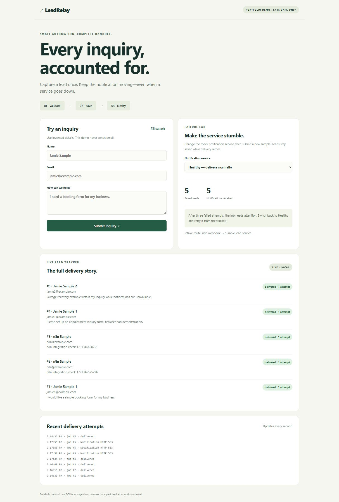

# LeadRelay

A self-built portfolio demo: inquiry form → validated lead → durable notification queue → mock notification receipt. No real email, credentials or paid services are required. This is a local demo, not a production customer system.



## Quick start

Requires Node.js 22.13 or newer (the bundled SQLite API may emit an experimental warning).

```powershell
git clone https://github.com/cracthatrock/LeadRelay.git
cd LeadRelay
npm start
```

Open http://127.0.0.1:4196. No npm dependencies need installing. `npm test` runs the integration checks with an isolated temporary database.

## Try the demo

1. Click **Fill sample**, then **Submit inquiry**. Watch the lead become delivered.
2. Submit the same unchanged details again. The response identifies the existing lead; there is one notification receipt.
3. Select **Temporary failure**, fill a new sample and submit. The first delivery fails; the next succeeds.
4. Select **Outage**, fill a new sample and submit. Three attempts leave the job in **failed** state, but the inquiry remains saved.
5. Switch to **Healthy** and click **Retry delivery** on that failed job. It becomes delivered.
6. **Slow response** demonstrates a 500 ms notification timeout.

Mock modes are global to this demo, so pending jobs share the selected setting. Automatic retry waits increase exponentially: approximately 1 second, then 2 seconds, before the third attempt. Failed jobs require a manual retry. The UI refreshes every second.

## Real n8n routing

The provided `workflow.json` is an importable webhook workflow. n8n performs intake orchestration; the local service owns validation, SQLite persistence and durable notification retries. This deliberately avoids pretending that an HTTP retry alone is a durable queue.

```powershell
docker compose up -d
```

Open http://localhost:5686, complete n8n's local owner setup yourself, and import `workflow.json`. Publish the workflow. Docker Desktop on the tested Windows machine reaches the loopback service. Enable routing with:

```powershell
$env:N8N_WEBHOOK_URL = 'http://127.0.0.1:5686/webhook/lead-relay'
npm start
```

Stop the previously running service first if the port is occupied. Alternatively copy `.env.example` to `.env` and set these values. n8n's HTTP node uses `host.docker.internal:4196`; change that URL if your host or port differs. Native n8n on the same machine can use `127.0.0.1:4196` instead.

The published webhook is `/webhook/lead-relay`. The temporary test endpoint is `/webhook-test/lead-relay` and only runs while the editor is listening. Validation errors return 400, new leads 201 and duplicates 200 through the response node. The UI tells you whether intake uses n8n or the local service.

Docker runs pinned n8n 2.42.3, with its UI port exposed on loopback only. `docker compose stop` stops it without removing data. Its owner credentials belong to you; no credentials are stored in the workflow export. No cloud account is needed.

## API contract

`POST /api/inquiries`: public form route; forwards to configured n8n or calls local intake.

`POST /api/intake`: n8n's local persistence endpoint. JSON fields:

```json
{"name":"Jamie Sample","email":"jamie@example.com","inquiry":"Build a booking form."}
```

Response example:

```json
{"statusCode":201,"duplicate":false,"leadId":1}
```

Other local demo endpoints: `GET /api/state`, `POST /api/mock-mode` with `mode`, `POST /api/retry` with `jobId`, and `POST /mock/notify` with `jobId`. Notifications never leave the machine.

## Reliability and limits

- A single SQLite transaction creates the lead and its notification job. A crash cannot save one without the other.
- An exact normalized name/email/inquiry fingerprint prevents duplicate inserts, including simultaneous requests. Email is lowercased and whitespace at field edges is trimmed. Identical content is deduplicated permanently, so a production system should use submission IDs and a documented retention window instead.
- The queue persists status, attempts and next retry time across process restarts. The single worker processes one job at a time; run only one service process per database. Multi-worker deployment would need atomic claims/leases.
- Delivery is at least once. The mock receiver deduplicates by job ID. Real providers need equivalent idempotency or receipt reconciliation to avoid duplicate messages after an ambiguous timeout.
- All form content is rendered as text. Input lengths and total body size are bounded. Browser writes from foreign origins are rejected.
- No authentication, user isolation, rate limiting, backups, deletion/retention policy or real notification adapter is included. Keep the service on loopback and never expose it publicly. Other host environments may need a different Docker networking arrangement.
- The tracker contains the supplied form data. Use fake data only.

## Delivery package

`src/`: readable service and store modules. `public/`: form and tracker. `workflow.json`: n8n export. `test/`: failure/recovery tests. `compose.yaml`: optional local n8n. `.env.example`: non-secret configuration. `TEST-RESULTS.md`: verification record.

## Portfolio description

“LeadRelay is a local inquiry automation demo I built with AI assistance. It validates form input, saves leads and notification jobs atomically, prevents duplicate submissions, retries failures and exposes a clear recovery path. Includes an n8n webhook workflow, integration tests and setup documentation. Self-built demonstration; no paying-client or production-use claims.”

Official references: [n8n Webhook](https://docs.n8n.io/integrations/builtin/core-nodes/n8n-nodes-base.webhook), [n8n HTTP Request](https://docs.n8n.io/integrations/builtin/core-nodes/n8n-nodes-base.httprequest).
